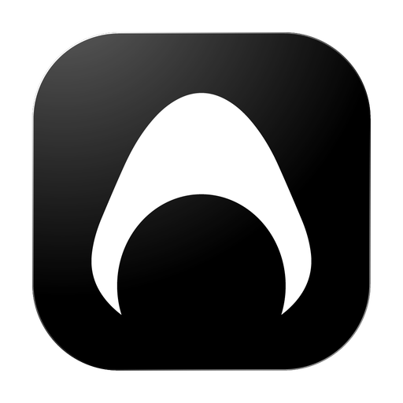
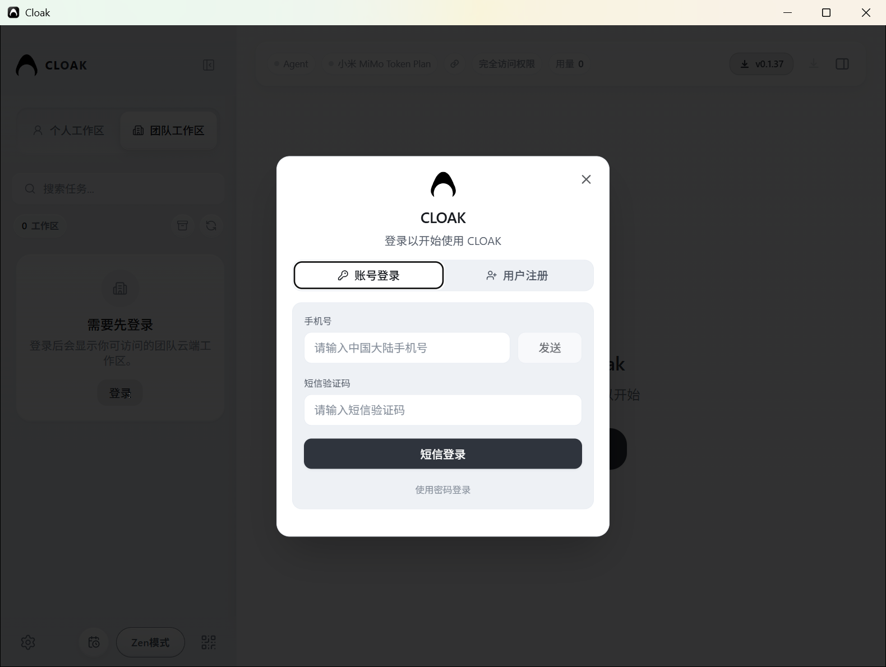
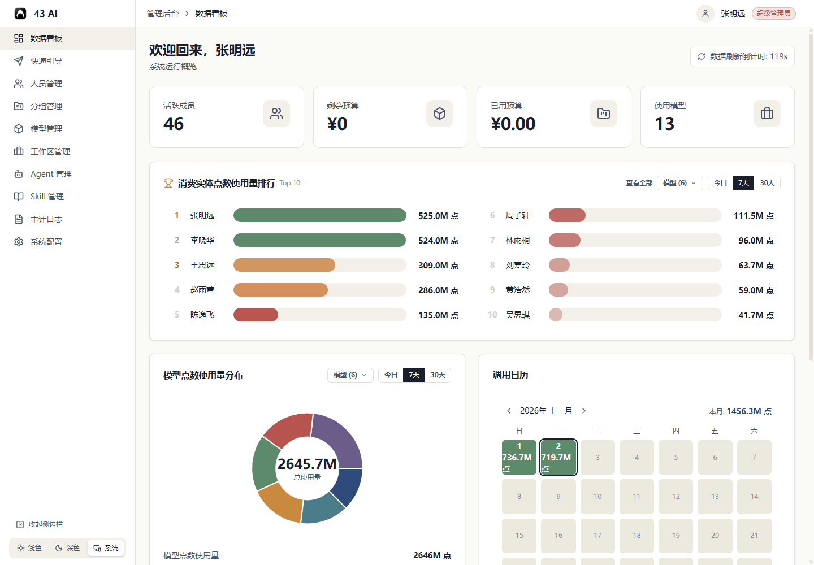
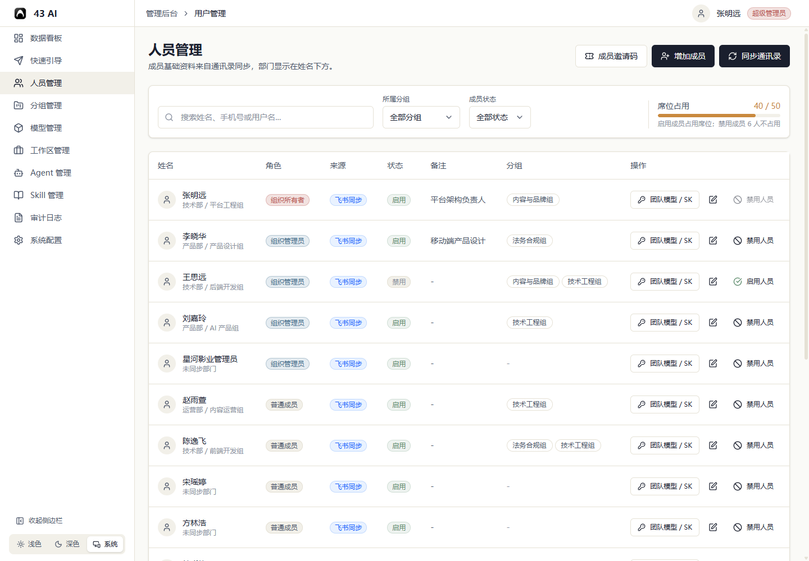
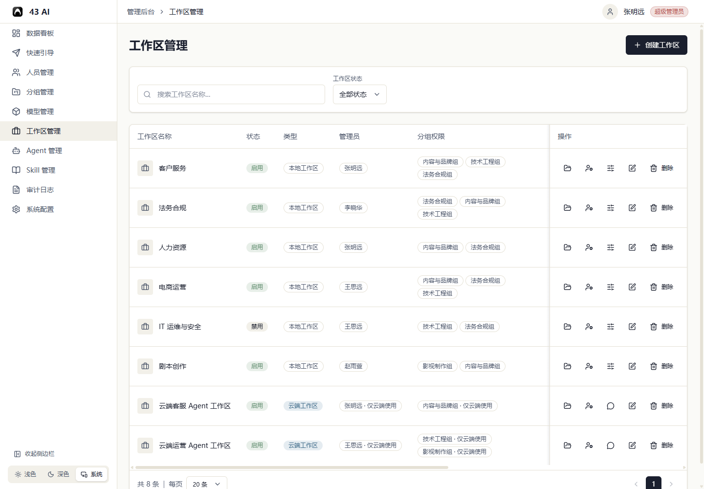
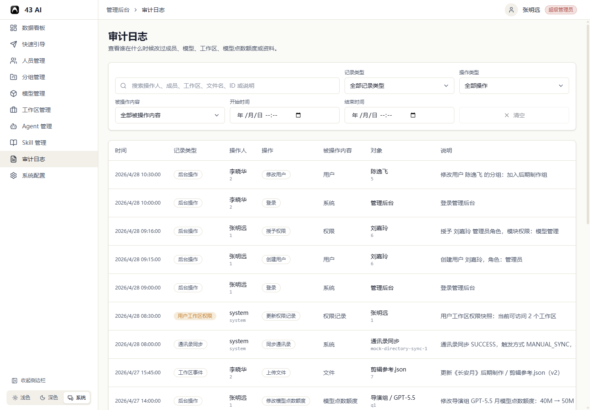
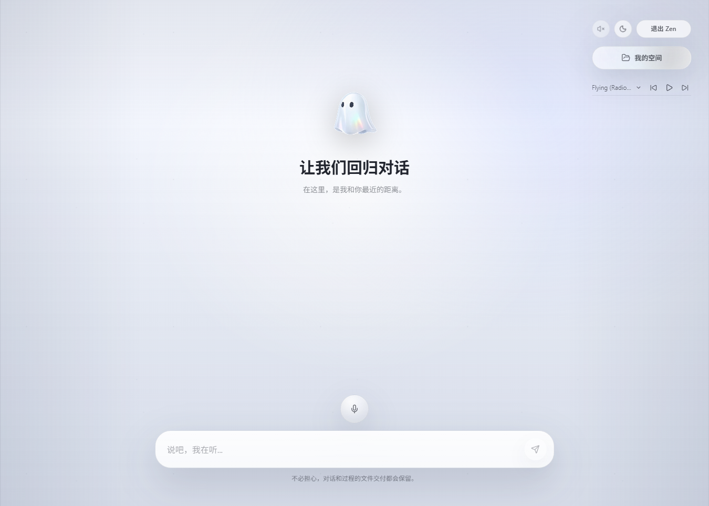
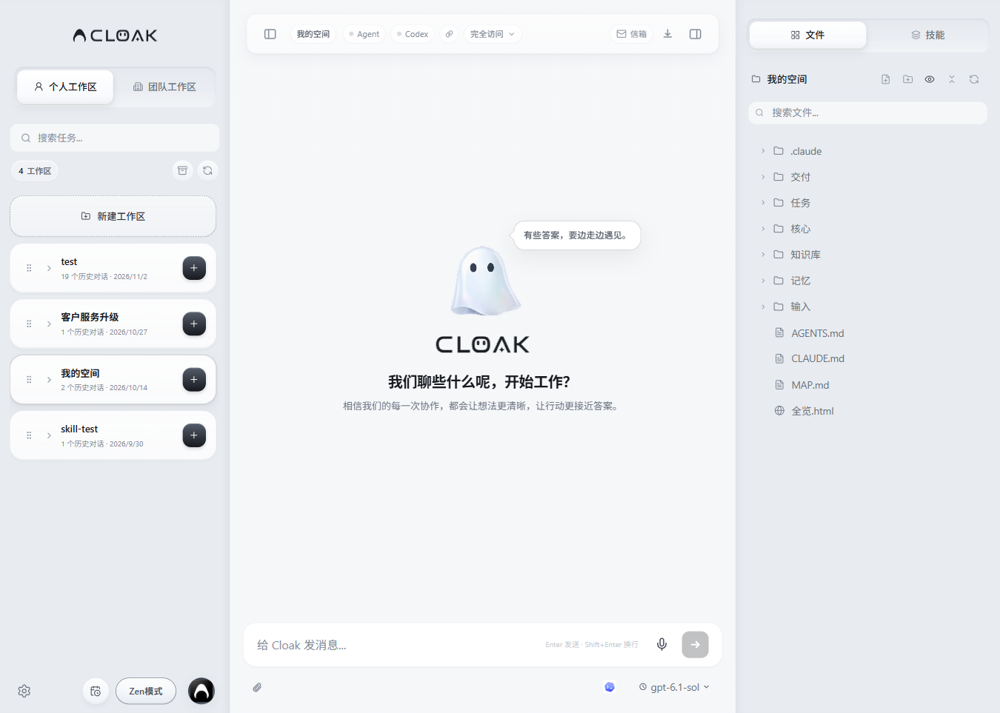
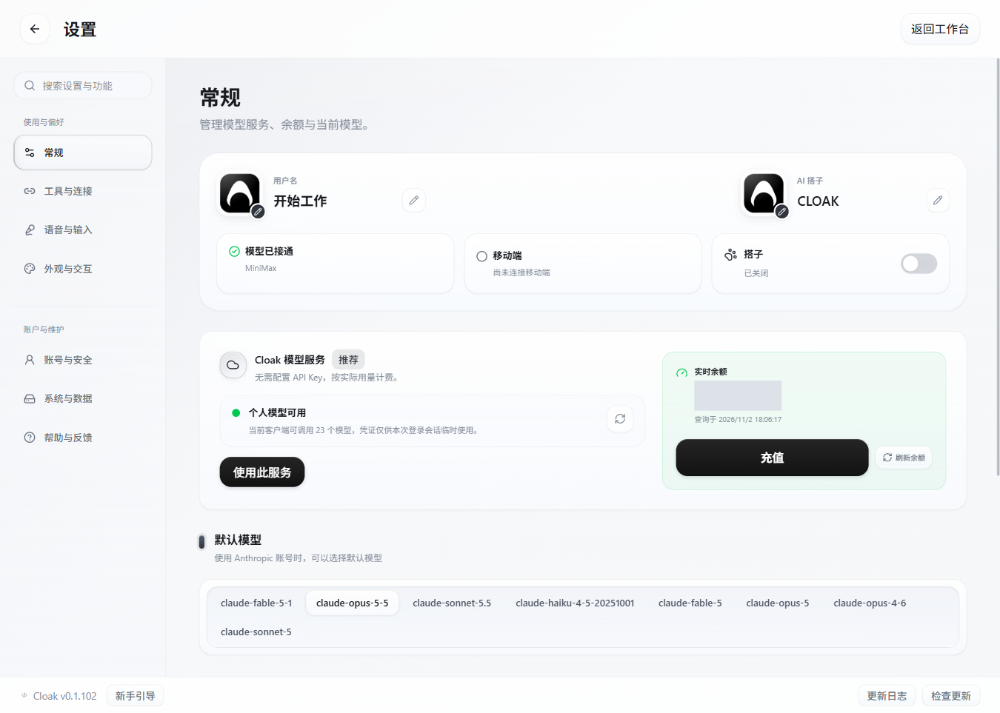
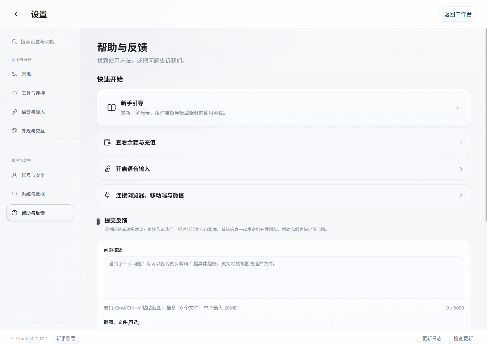

# 43 CLOAK

**面向个人与团队的 AI 工作台**

Cloak 是面向个人与团队的桌面端 AI 工作台，支持对话、文件处理和团队工作区协作。

官方网站：[www.43cloak.cn](https://www.43cloak.cn/)

**使用支持与组织配置咨询：扫码联系 CLOAK 团队。**

## 目录

- [43 CLOAK 是什么](#43-cloak-是什么)
- [下载](#下载)
- [3 分钟上手](#3-分钟上手)
- [为什么团队需要 CLOAK 团队版](#为什么团队需要-cloak-团队版)
- [团队版能力](#团队版能力)
- [团队管理后台预览](#团队管理后台预览)
- [通用基础能力](#通用基础能力)
- [客户端界面预览](#客户端界面预览)
- [更新记录](#更新记录)
- [常见问题 Q&A](#常见问题-qa)
- [反馈与建议](#反馈与建议)
- [联系我们](#联系我们)

---

## 43 CLOAK 是什么

43 CLOAK 是一款**桌面端 AI 工作台**。你可以通过对话发起任务，把文件、项目资料和团队文档交给 AI 处理。

对团队和组织，Cloak 团队版提供：

- **团队工作区**：在客户端访问团队资料、云端文件和团队群聊。
- **管理后台**：配置组织权限、成员分组、模型、资源使用规则和审计记录。
- **模型服务**：成员使用组织分配的模型，通常无需自行维护 API Key。

对个人用户，Cloak 可以围绕电脑中的文件夹完成阅读、总结、改写、分析和计划整理。文件夹移动或更名后，可以重新关联并继续历史任务。微信接入、语音和扩展工具按需开启。

当前桌面客户端支持**个人工作区**与**团队工作区**。团队工作区、云端文件和后台管理需由组织开通并完成配置。

> 本项目早期工作参考借鉴了 [TOKENICODE](https://github.com/yiliqi78/TOKENICODE)，在此致谢原作者（@小七姐，@Tiny）。
>
> Cloak 及其第三方组件的使用、修改和分发范围，以各自随附的许可证为准。团队服务的开通与使用按对应服务协议执行。

---

## 下载

> 当前版本：**0.1.105**（Windows、macOS M 系列）；**0.1.86**（macOS Intel）；**0.1.89**（Linux AppImage）。

首次安装只需选择与你电脑对应的安装包。已安装用户需要更新时，按客户端提示处理。

安装包通过 Cloak 官方云端发布；GitHub 历史发布页（可能滞后于客户端更新）：[43-COLLEGE-TEAM/Cloak](https://github.com/43-COLLEGE-TEAM/Cloak/releases)。

| 系统 | 下载 |
|------|------|
| Windows | [下载安装包（v0.1.105）](https://7n.cdn.43cloak.cn/cloak/release/v0.1.105/Cloak_0.1.105_x64-setup.exe) |
| macOS（M 系列芯片）| [下载安装包（v0.1.105）](https://7n.cdn.43cloak.cn/cloak/release/v0.1.105/Cloak_0.1.105_aarch64.dmg) |
| macOS（Intel 芯片）| [下载安装包（v0.1.86）](https://qn.oss.43consult.com/cloak/release/v0.1.86/Cloak_0.1.86_x64.dmg) |
| Linux AppImage | [下载 AppImage（v0.1.89）](https://qn.oss.43consult.com/cloak/release/v0.1.89/Cloak_0.1.89_amd64.AppImage) |

不知道自己的 Mac 是哪种芯片？点击屏幕左上角的苹果图标，选择**关于本机**，查看“芯片”一栏。写着 M1 / M2 / M3 / M4 就选 M 系列，写着 Intel 就选 Intel。

---

## 3 分钟上手

操作演示：[3 分钟上手视频](https://vcnfaf5fobac.feishu.cn/wiki/Su2nwGBaMiLBMYkdbScc0XMDnDc#DxCfd835Vob8ukxNxCZcoAo2ndf)。

### 1. 安装客户端

- **Windows**：双击下载好的安装文件，按提示完成安装。
- **macOS（M 系列）**：打开下载的 DMG 文件，把 Cloak 图标拖到“应用程序”文件夹。
- **macOS（Intel）**：打开下载的 DMG 文件，把 Cloak 图标拖到“应用程序”文件夹。
- **Linux**：下载 AppImage，右键文件进入属性，允许作为程序执行后打开。

### 2. 选择使用路径

**组织成员**

> 仅使用团队工作区时需要加入组织；已加入的成员可直接进入工作区。

- **成员登录**：使用账号密码或短信验证码登录 Cloak。
- **加入组织**：向管理员获取邀请码，在客户端组织菜单中输入；注册时也可填写组织邀请码。
- **资料与权限**：由管理员分配工作区、文件权限和可用模型。
- **模型服务**：使用组织开放的模型，通常无需自行配置个人模型。

完整流程：[从创建组织到成员进入团队工作区](https://vcnfaf5fobac.feishu.cn/wiki/Nv24wSq6ziDjxTk3zLWcIkYYnzc)。

**个人用户**

> 以下三种模型接入方式任选一种；已有可用模型时无需重新配置。

打开左下角**设置 → 常规**，按所选方式配置。使用自己的 API Key 或 Anthropic / OpenAI 账号授权时，无需登录 Cloak 或加入组织。

#### 方式一：使用 Cloak 模型服务

使用此方式需登录 Cloak。账号开通后可选择云购个人模型，可用模型、余额和计费信息以账号页面显示为准。已开通的账号可从第 3 步开始。

**第 1 步：登录或注册账号**

已登录时可跳过本步。

点击左侧**团队工作区**中的**登录**，或打开**设置 → 常规 → Cloak 模型服务 → 登录 / 注册**，再按账号情况选择：

- **已有账号**：使用账号密码或短信验证码登录，任选一种即可。短信登录时，输入中国大陆手机号，点击**发送**，填写验证码后点击**短信登录**。
- **没有账号**：切换到**用户注册**，按提示填写用户名、手机号、验证码和密码，点击**创建账号并登录**。组织邀请码为选填项；个人用户可留空。

**第 2 步：查看开通状态**

登录后，回到**设置 → 常规**，查看 **Cloak 模型服务** 卡片：

- 显示**个人模型可用**：账号已开通，继续第 3 步。
- 显示**申请开通**：点击该入口，在弹窗中填写**邀请人姓名**，再点击**提交申请**。
- 提交后显示**申请处理中**：等待平台管理员审批。审批通过后会自动开通并同步模型，可点击卡片右侧的刷新按钮查看最新状态。

不知道邀请人姓名时，请向邀请你使用的人员确认；页面没有申请入口时，可通过**设置 → 帮助与反馈**提交问题。

*截图来自 Windows 客户端 v0.1.102，余额已遮挡。模型数量和余额以你账号实际显示为准。*

**第 3 步：确认模型服务**

1. 显示**个人模型可用**后，点击**使用此服务**；已经选中时可跳过。
2. 在**默认模型**中保留当前选择，或按需更换。可选模型以账号显示为准。

**余额与上下文设置**

- **余额**：卡片右侧显示**实时余额**，需要更新时再点击**刷新余额**。
- **充值**：余额不足时再点击**充值**，使用当前账号完成操作。返回客户端后会自动刷新余额，也可手动刷新。
- **上下文长度**：使用云购 Claude 模型时，可保持默认设置，或按需开关 **1M 上下文**。更改在下一次发送时生效，实际容量以所选服务为准。

**第 4 步：回到个人工作区，开始对话**

点击**返回工作台**，按[开始对话](#3-开始对话)开始对话。已有工作区可直接打开，无需重新选择文件夹；继续历史任务时，打开原会话即可。

每个会话会记住自己的模型选择。继续旧任务时，请确认当前会话中的模型名称。

**常见提示**

| 页面提示或问题 | 怎么处理 |
|---------------|----------|
| 申请未通过 | 查看页面给出的原因，核对邀请人姓名；页面允许重新申请时，修改后再次提交。 |
| 开通处理异常 | 联系 CLOAK 团队检查开通状态，无需重复提交申请。 |
| 暂不可申请、尚未配置或没有可用模型 | 先确认登录的是申请开通的账号，再点击卡片右侧刷新；仍未恢复时联系 CLOAK 团队。 |
| 余额查询失败 | 检查网络后点击刷新余额；仍失败时，记录页面提示并联系 CLOAK 团队。 |
| 提示 Agent 尚未就绪 | 进入**设置 → 系统与数据 → 诊断**查看运行环境状态，按界面提示完成准备；若持续异常，可通过**设置 → 帮助与反馈**联系 CLOAK 团队。 |

#### 方式二：使用自己的 API Key

有自己的 API Key 时选择此方式。内置服务商和自定义服务任选其一，只需配置所选服务。

- **内置服务商**：选择服务商，填写自己的 **API Key**。Base URL 和模型清单已有默认值，通常无需修改；服务提供方另有要求时，再进入高级设置调整。
- **自定义模型服务**：选择**自定义配置**，按服务提供方的说明选择 Anthropic 或 OpenAI 协议，并填写 **Base URL、API Key 和模型清单**。请使用你有权访问的服务。

按所选服务获取 API Key。已有 Key 时，可直接配置，无需再次获取：

| 服务 | 获取 API Key | 配置指南 |
|------|-------------|----------|
| 小米 MiMo Token Plan | [前往获取](https://platform.xiaomimimo.com/#/console/plan-manage) | [Token Plan 配置](https://vcnfaf5fobac.feishu.cn/wiki/ZQuCwW3aIio1L0kuCwIcZaJjngb) |
| 小米 MiMo | [前往获取](https://platform.xiaomimimo.com/) | [API 配置](https://vcnfaf5fobac.feishu.cn/wiki/VKxjwJwhZiT2wckyxxScVBhvnpE) |
| Anthropic（Claude） | [前往获取](https://console.anthropic.com/account/keys) | — |
| 智谱 GLM | [前往获取](https://bigmodel.cn/usercenter/proj-mgmt/apikeys) | [API 配置](https://vcnfaf5fobac.feishu.cn/wiki/P8BWwdvLoicRrbkf24OcR157n1g) |
| Kimi | [前往获取](https://platform.moonshot.cn/console/api-keys) | [API 配置](https://vcnfaf5fobac.feishu.cn/wiki/QAjIwpnZmi9WE3kAM8JcWkDDnPg) |
| Kimi Code | [前往获取](https://www.kimi.com/code/console) | [Kimi Code 配置](https://vcnfaf5fobac.feishu.cn/wiki/M9ctwKXWaiS6Dbk0rJVcyNNanKg) |
| MiniMax | [前往获取](https://platform.minimaxi.com/user-center/basic-information/interface-key) | [Token Plan 配置](https://vcnfaf5fobac.feishu.cn/wiki/F3z1wqUPgioYTokOEjSceBZTnUh) |
| DeepSeek | [前往获取](https://platform.deepseek.com/api_keys) | [API 配置](https://vcnfaf5fobac.feishu.cn/wiki/UONIw28NIi8XtBkoFi3caQLKncb) |

#### 方式三：使用 Anthropic / OpenAI 账号登录

使用 Claude 或 ChatGPT 账号时选择此方式。两者任选一个，已有有效授权时无需重复登录；此授权与 Cloak 账号登录分别进行。

在**方式三 · 账号登录**中选择 **Anthropic** 或 **OpenAI**，点击**登录**并按提示完成授权。Anthropic 使用 Claude 账号或订阅；OpenAI 使用 ChatGPT 账号，通过 Codex 执行任务。如果提示**准备运行环境**，先按页面引导完成准备，再返回登录；授权后可点击**刷新状态**确认是否可用。

Claude Code 已随 Cloak 一起提供，启动时会自动准备运行环境。仅在准备失败时，按提示重试或进入**设置 → 系统与数据 → 诊断**检查；持续异常时可通过**设置 → 帮助与反馈**提交问题。

### 3. 开始对话

需要开始新话题时再新建任务。继续已有任务，可直接打开原会话并输入需求，无需重新创建工作区、选择文件夹或配置模型。

1. 首次使用个人工作区时，在欢迎界面点击**选择文件夹**；已有工作区可直接打开。组织成员进入已分配的团队工作区。
2. 点击左上角**新建任务**。已有可用 Agent 和模型时可保持当前选择，需要更换时再调整。
3. 输入需求并发送，例如：“帮我整理这个文件夹里的资料，列出主要内容和待办事项。”

- **添加文件**：需要 AI 看文件时，再把文件拖进对话框；文字对话可直接发送。
- **发送快捷键**：在**设置 → 语音与输入**选择 `Enter` 或 `Ctrl / Command + Enter`，也可保持默认。

不同话题可以分别新建任务。任务进度会在支持该能力的对话中显示；AI 处理期间，可以编辑排队中的输入或补充当前任务。个人对话和团队群聊中的消息可以复制，自己的消息还可以编辑后重新发送。

需要预览或编辑 Office 文件时，到**文件**面板打开 DOCX、XLSX 或 PPTX。Word 和 Excel 支持简单编辑、保存和另存为，PowerPoint 支持预览。复杂版式可能变化，编辑前请保留原件。

需要生成配音时，可直接在对话中提供文稿和要求；试听候选音色后，回复音色编号或名称，生成完整配音。

需要在微信里继续对话时，再到**设置 → 工具与连接 → 接入微信**扫码连接，并保持客户端运行。手机文件预览按需开启。

需要口述文字或收听回复时，再到**设置 → 语音与输入**开启对应功能。Zen 语音需开通云购个人模型并保持余额充足；跨应用语音输入目前支持 Windows 和 macOS，需开通云购个人模型。

---

## 为什么团队需要 CLOAK 团队版

团队使用 AI 时，可以由组织集中配置资料、成员权限和模型服务：

- **资料协作**：围绕项目或部门工作区使用团队文件和知识资料。
- **权限分配**：按成员、分组和角色设置文件与工作区访问范围。
- **模型配置**：管理员设置可用模型，成员使用已分配的服务。
- **用量与记录**：查看资源使用情况，并通过审计记录排查权限、模型和工作区变化。

---

## 团队版能力

团队版由两部分组成：

- **客户端团队工作区**：给成员使用，连接团队资料、云端文件和组织配置的模型。
- **团队管理后台**：给管理员使用，统一管理成员、分组、工作区、模型、资源配置和审计记录。

成员可以按要做的事情选择工作区：

- **在电脑上处理团队文件**：进入标有 `本地` 的工作区，让 AI 帮你整理资料、修改方案，检查完成后再把修改交给团队。
- **和同事、AI 一起讨论任务**：进入标有 `云端` 的工作区，在群聊中协作，生成的文件到右侧 `交付中心` 查看或另存为。

左侧的 `个人工作区` 用于处理自己选定的电脑文件夹。团队分配的项目从 `团队工作区` 进入。具体步骤参见[团队工作区使用指南](docs/manual/2-客户端使用指南/03-团队工作区.md)。

需要分享个人工作区时，组织所有者或有权限的管理员可右键工作区，选择**推送至团队工作区**，再选择团队存放位置和协作人员。使用已分配的团队工作区时无需执行此操作。

| 模块 | 功能说明 |
|------|------------------|
| 团队工作区与文件 | 本地工作区供成员处理项目文件，并按权限提交修改；重新关联文件夹和切换工作区后，文件与版本记录也能正常显示。云端工作区通过交付中心集中展示产物，支持预览、另存为和在本机继续处理。 |
| 账号登录与成员同步 | 成员使用账号密码或短信验证码登录，可通过组织邀请码加入组织。完成通讯录接入及所需授权后，可按授权范围同步成员、邮箱和部门等信息。 |
| 用户、分组、角色与资源配置 | 按成员、分组、角色和项目范围分配权限；为不同团队设置可用模型、访问范围和资源使用规则。 |
| 模型统一管理 | 组织统一配置成员可用的模型范围；普通成员只看到自己被允许使用的模型；团队工作区会按组织配置加载模型。 |
| 工作区权限与文件管理 | 围绕工作区管理成员、分组、文件变更记录和访问权限，适合项目资料库、部门知识库和外部协作场景。 |
| 团队群聊协作 | 在团队工作区中围绕同一主题组织多方 AI 协作，支持团队群聊房间、成员邀请与移除、AI 同事工作状态与本轮进展查看、消息状态和连接恢复，让多个智能体一起讨论、补充和审阅任务。 |
| 数据看板与用量概览 | 查看活跃成员、预算、使用模型和模型点数趋势；用量图表会按实际接入情况展示，帮助团队了解资源使用。 |
| 客户端版本与审计追溯 | 查看客户端相关信息，追踪关键操作记录，排查权限、资源配置、模型和工作区变化。 |
| 系统配置 | 配置组织名称、Logo、显示偏好和后台基础信息，让团队内部使用入口更清晰。 |

---

## 团队管理后台预览

管理后台可按组织角色开放不同菜单。以下为团队管理能力示例，截图中数据为演示数据。

**数据看板：查看活跃成员、预算、使用模型和模型点数趋势**

**人员管理：管理成员角色、模块权限、模型配额和客户端配置**

**工作区管理：按项目、部门或资料库管理成员、分组和文件权限**

**审计日志：追溯成员、权限、模型、工作区和文件相关操作**

---

## 通用基础能力

以下功能按需使用，文字对话无需预先配置微信、语音、技能或电脑操作工具。

个人工作区和团队工作区都可以使用这些通用能力；团队版会在此基础上增加**组织、权限、模型、资源使用和后台管理**。

- 💬 **多个任务同时进行**：不同话题分开处理，互不打扰，随时切换回来继续；可从最近会话入口查看和继续任务；支持任务进度的对话会显示当前步骤，长任务状态更容易跟进；设置中可选择调用子智能体无响应时的持续等待时间；AI 正在处理时，也可以编辑排队中的输入或直接补充到当前任务；发送快捷键可在 `Enter` 与 `Ctrl / Command + Enter` 之间选择；代码内容默认换行显示，阅读长代码更轻松。
- 📁 **直接处理文件和图片**：把文件或图片拖进对话窗口，让 AI 阅读、总结、改写、提取重点或分析内容；图片可以更可靠地发送给 Claude Code 与 Codex，聊天中的本地文件和文件夹链接、外部文件链接也可更直接地预览、定位和打开。聊天中的图片还可右键添加到聊天、复制图像或下载副本。
- 🎨 **生成图片、视频和配音**：在任意会话中描述想要的画面，生成图片时可使用多张参考图，团队本地工作区也支持生成，完成后可直接在对话中查看；也可以提供文稿生成配音，先试听并选择音色，再生成完整音频。
- 🗂️ **文件管理**：在**文件**面板搜索、预览、打开文件，Markdown 预览支持全文检索并跳转到匹配内容，也可以一键收起整棵文件树、全屏查看预览内容，或把文件插入对话继续提问；支持 Word（DOCX）、Excel（XLSX）和 PowerPoint（PPTX）预览，Word 和 Excel 还可简单编辑并保存；支持预览更大的文件，超出上限时可定位文件或用系统应用打开；团队本地工作区支持查看文件变化，并按权限将修改交给团队。
- 🎙️ **Zen 模式与语音**：在 Zen 模式中整理问题、查看文件、口述内容或收听 AI 回复；可在**设置 → 语音与输入**开启 Zen 语音、选择和试听音色，也可开启跨应用语音输入并查看历史记录；普通对话也可点击输入框旁的麦克风口述内容。语音服务需开通云购个人模型并保持余额充足。
- 🤖 **模型选择**：团队工作区使用组织配置的模型；个人用户可选择云购模型、自有 API 或 Anthropic / OpenAI 账号。模型配置会标注输入能力，每个会话也会记住当前选择；云购 Claude 模型可按需开关 **1M 上下文**。
- 🛠️ **Agent 选择**：可在 Claude Code 和 Codex 之间切换，并按需调整操作权限；对话所需内容随 Cloak 一起更新，启动时统一准备。可在**设置 → 系统与数据**查看准备状态，并在**诊断**中重新检查环境。
- 🔌 **MCP 服务管理**：需要连接外部工具时，可在**设置 → 工具与连接 → 连接器管理**中管理 MCP 服务，同一服务可供 Claude Code 和 Codex 使用，并分别控制开关；聊天中的工具活动会分组展示，MCP 工具调用仍可集中查看，长任务过程更容易跟进。
- 🖥️ **Computer Use（测试）**：需要 AI 查看屏幕并操作电脑时，再到**设置 → 工具与连接**中开启并完成授权后，新建的 Claude Code 和 Codex 会话可以查看屏幕并操作电脑；目前支持 Windows 和搭载 Apple 芯片、运行 macOS 14 及以上版本的 Mac。
- 🌐 **Browser Use**：需要处理网页任务时，再到**设置 → 工具与连接**中开启 **Browser Skill**，安装并连接 Chrome 或 Edge 扩展后，让 AI 沿用已有标签页和登录状态处理网页任务。
- 📬 **系统信箱**：登录后可集中查看公告与通知，筛选未读消息、标记已读或清除消息。
- 💬 **微信接入预览**：需要在手机继续对话时可扫码接入，连接后，可以在微信里继续当前工作区的对话，查看当前会话、切换工作区、切换最近会话、新建会话和查找文件；开启文件预览后，还可预览有权读取的本地工作区文件，并按需添加其他目录。
- 🧠 **技能库**：需要特定技能时，在 Skills 面板中搜索、安装和更新可用 Skills，并查看技能作者信息；在对话输入框中输入 `/` 即可查找和使用技能。面板会显示已启用数量和总数，方便随时使用。
- 📌 **任务中心**：可以在对话中让搭子创建 AI 会话任务或提醒，集中查看和安排需要稍后处理的内容；任务和提醒在重启后仍会保留，并可处理错过的计划。定时任务可绑定当前工作区的已有会话；个人工作区可为任务指定云购模型，团队任务使用工作区规定的模型。
- 🧹 **会话保留设置**：可在**设置 → 系统与数据 → 存储清理**中调整 Claude Code 会话自动清理周期，长期任务不容易被过早清理。
- 📦 **产物与交付中心**：AI 生成或交付文件后，界面会提示新产物；不需要提醒时，可在**设置 → 外观与交互**中关闭交付物通知。团队工作区还可以集中查看云端交付内容，缓存后可预览、另存为、在文件管理器中定位或用默认应用打开，并像普通本地文件一样继续处理。
- 🎨 **个性化工作台**：支持亮色 / 暗色、主题颜色、字体大小、中英文界面、项目卡片皮肤、工作区背景和任务完成提示音；云端工作区封面也可以使用组织提供的皮肤资源。
- 🧩 **工作搭子**：Cappa 会在聊天页和 Zen 中陪伴你；桌面工作搭子也支持尺寸调节、资源缓存和显示管理，云端资源支持更多操作。
- 🌙 **系统避免休眠（macOS）**：可在**设置 → 系统与数据**中选择关闭、持续开启或开启 24 小时，减少长任务和移动端连接因 Mac 闲置休眠而中断。
- ⬆️ **应用更新提醒**：客户端会检查当前版本是否仍可继续使用；需要更新时会提示下载并重启完成更新，非强制更新也可以选择稍后处理。
- 🪟 **窗口记忆**：Cloak 会记住主窗口大小，下次打开时更容易回到熟悉的工作界面。
- 💌 **问题反馈**：在**设置 → 帮助与反馈**提交问题描述、截图、文件和联系方式。
- 🧾 **问题排查**：在**设置 → 系统与数据 → 诊断**中查看本地日志、调整记录级别；需要协助排查时，可主动开启远程调试，退出 Cloak 后会自动关闭。

---

## 客户端界面预览

**欢迎界面**

**主界面**

**Zen模式**

**文件管理**

**设置**

---

## 更新记录

这里只展示最近 3 次更新，完整记录见 [CHANGELOG.md](CHANGELOG.md)。

**v0.1.105**

- 更新浏览器操作能力，优化网页任务体验。
- 修复部分情况下 Office 文件预览不显示的问题。

**v0.1.104**

- 新增配音功能，可先试听音色，再生成完整配音。
- Markdown 文件预览支持全文检索并跳转到匹配内容。
- 优化语音输入的文字整理，让内容层次更清晰。
- 新增最近会话入口，方便查看和继续任务。

**v0.1.103**

- 优化安装、卸载与更新重启体验。

---

## 常见问题 Q&A

### 团队版开通与管理

**Q：团队版开通后，成员还需要自己配置 API Key 吗？**

A：通常不需要。组织可以统一配置**模型服务和可用模型**，成员登录后使用组织分配的模型和工作区。个人模型配置见[模型配置](#2-选择使用路径)。

**Q：怎样加入组织？**

A：仅使用团队工作区时需要加入组织。向组织管理员获取邀请码，在客户端组织菜单中输入邀请码加入；已加入时无需重复操作。工作区和模型权限由管理员分配。

**Q：管理员能看到哪些后台能力？**

A：后台菜单按组织角色开放。常见模块包括**数据看板、人员管理、分组管理、模型管理、工作区管理、Agent 管理、Skill 管理、审计日志和系统配置**。不同角色看到的菜单会有差异。

**Q：左侧看不到团队工作区，是不是应用坏了？**

A：通常不是。请先确认三件事：**客户端账号已登录、账号已加入组织、管理员已分配对应工作区**。

**Q：团队文件能看到但打不开、不能下载或不能带入对话，是为什么？**

A：这通常和**工作区权限**有关。部分账号只能浏览目录，不能读取内容、下载文件或把文件带入对话；需要联系组织管理员或 CLOAK 团队调整权限。

### 下载与安装

**Q：我不知道该下载哪个安装包。**

A：Windows 选 Windows。Mac 查看“关于本机”的芯片信息：

- **M1 / M2 / M3 / M4**：选 M 系列
- **Intel**：选 Intel
- **Linux**：选 AppImage

**Q：Windows 打开后提示缺少基础组件怎么办？**

A：新版已随应用提供所需基础组件。进入**设置 → 系统与数据 → 诊断**查看运行环境状态，按界面提示完成准备；若持续异常，可通过**设置 → 帮助与反馈**联系 CLOAK 团队。

**Q：macOS 提示没有权限访问文件怎么办？**

A：仅在读取所需文件时遇到权限提示，再按提示检查系统授权。若仍因系统权限限制无法访问，可到“系统设置 → 隐私与安全性 → 完全磁盘访问权限”里给 Cloak 授权，然后重启应用再试；能正常读取文件时无需额外开启。

**Q：怎样在 Cloak 中预览或编辑 Office 文件？**

A：直接从**文件**面板打开 DOCX、XLSX 或 PPTX；如果之前关闭过预览，可在文件预览页重新启用。Word 和 Excel 支持简单编辑，可保存到原文件或另存为副本；PowerPoint 仅支持预览。复杂版式可能变化，建议保留原件，需要完整编辑时可使用默认应用打开。

**Q：怎样在 Markdown 预览中查找内容？**

A：打开 Markdown 文件预览，使用查找入口输入关键词，即可全文检索并跳转到匹配内容。

### 模型、API Key 与网络

**Q：模型服务由谁配置？**

A：组织成员由组织统一配置**模型服务、成员权限和资源使用规则**。个人用户可以使用云购个人模型、接入自己的 API Key，或使用 Anthropic / OpenAI 账号登录。

**Q：个人用户一定要填写 API Key 吗？**

A：不一定。个人用户可选择 Cloak 模型服务、自己的 API Key 或账号授权，操作步骤见[模型配置](#2-选择使用路径)。

**Q：怎样调整云购 Claude 模型的上下文长度？**

A：进入**设置 → 常规**，在 **Cloak 模型服务** 中点击**使用此服务**，在 Claude 模型列表旁调整 **1M 上下文**开关。默认开启，使用 1M 上下文，并在约 800K 时自动整理对话内容以继续任务；关闭后使用 200K。更改在下一次发送时生效，是否可用及实际容量以所选模型服务为准。

**Q：怎样使用 Codex Agent？**

A：先等待启动准备完成；如有异常，可在**设置 → 系统与数据**查看状态，并在**诊断**中重新检查。如需使用 OpenAI 账号，在**设置 → 常规 → 方式三 · 账号登录**完成授权。之后即可在任务输入区选择 Codex。切换 Agent 时，Cloak 会尽量带上当前任务的上下文。

**Q：Claude Code 和 Codex 可以使用同一个 MCP 服务吗？**

A：可以。在**设置 → 工具与连接 → 连接器管理**中管理 MCP 服务，两者共用服务配置，开关可分别控制。修改配置会影响后续连接；Codex 会在下一次空闲发送时应用更改。

**Q：怎样开启 Computer Use？为什么开关不可用？**

A：进入**设置 → 工具与连接**，开启 **Computer Use**，按引导完成权限设置和验证，再新建 Claude Code 或 Codex 会话使用。该功能仍在测试，目前支持 Windows 和搭载 Apple 芯片、运行 macOS 14 及以上版本的 Mac；Intel Mac 和 Linux 暂不支持。未完成授权或验证时，功能会保持关闭。

**Q：怎样让 AI 使用已登录的 Chrome 或 Edge 处理网页任务？**

A：在**设置 → 工具与连接**中开启 **Browser Skill**，选择 Chrome 或 Edge，点击**去安装 Browser Skill 扩展**。安装后，在浏览器工具栏打开扩展并开启连接，即可沿用已有标签页和登录状态。扩展商店无法打开时，可使用**离线安装扩展**，在扩展管理页面开启开发者模式，再按页面提示拖入**本文件夹**安装；从旧版升级后需重新开启 Browser Skill 并连接扩展。

**Q：怎样修改发送消息的快捷键？**

A：进入**设置 → 语音与输入**，可选择按 `Enter` 发送，或按 `Ctrl / Command + Enter` 发送。这个偏好会同时用于普通对话、Zen 模式和团队群聊。

**Q：怎样调整 Claude Code 会话的自动清理时间？**

A：进入**设置 → 系统与数据 → 存储清理**，在“会话自动清理”中设置保留天数。可设置 30–36500 天。

**Q：提示资源不足、模型不可用或请求失败怎么办？**

A：个人用户请检查**账户余额、可用模型、服务商状态和网络连接**。组织成员可以先按提示重试或切换备用模型；如果仍然不可用，请联系组织管理员查看**模型权限、组织资源上限和后台配置**。

**Q：公司网络、校园网或代理会影响使用吗？**

A：会。部分网络会限制访问**模型服务、GitHub、下载地址或二维码登录服务**。

可以换一个网络，或让网管放行相关访问。

### 微信与语音

**Q：怎样生成配音？**

A：在对话中提供文稿和配音要求。AI 会准备候选音色的短试听，试听后回复音色编号或名称，即可生成完整配音，并在聊天中播放或打开音频文件。

**Q：微信接入后可以做什么？**

A：可以在微信里继续当前工作区的对话，也可以查看当前绑定的会话、切换工作区、切换最近会话、新建会话和查找文件。使用时需要保持 Cloak 客户端运行。开启文件预览后，还可以预览有权读取的本地工作区文件，并按需添加其他目录。

**Q：Mac 休眠后长任务或移动端连接会中断，怎么办？**

A：进入**设置 → 系统与数据**，把“系统避免休眠”设为**持续开启**或**开启 24 小时**。该功能只在 Cloak 运行期间生效，不会阻止合盖或手动休眠。

**Q：Zen 模式语音需要怎么配置？**

A：先开通云购个人模型并保持余额充足，再进入**设置 → 语音与输入**开启语音输入和 **Zen 语音**，选择喜欢的音色并试听，回到 Zen 模式即可口述内容或收听 AI 回复。

**Q：怎样在其他应用中使用语音输入？**

A：先开通云购个人模型，再进入**设置 → 语音与输入**开启功能并按页面提示完成授权。按页面显示的快捷键开始口述，再按一次结束；整理后的文字会尝试输入到当前光标处。若输入未完成，可从提示卡片复制文字，或在语音输入历史记录中查找。

### 反馈与排查

**Q：遇到问题时，我应该怎么反馈才有用？**

A：写清楚三点最有用：**点了哪里、想做什么、出现了什么提示**。设置里的反馈页支持粘贴截图和选择文件。

**Q：反馈里要不要留下联系方式？**

A：联系方式为选填项。需要团队联系你跟进时，可留下**邮箱、微信或飞书手机号**；不留也可以提交。

---

## 反馈与建议

遇到问题或有建议时，打开**设置 → 帮助与反馈**填写说明。截图、附件和联系方式均为选填。

反馈时请说明：

1. 使用的系统和 Cloak 版本。
2. 点击了哪个入口，原本想完成什么。
3. 实际出现的提示或现象。

组织权限问题先联系组织管理员，反馈时请说明相关工作区和页面提示。

---

## 联系我们

使用支持或组织配置咨询，可通过本页开头的微信二维码联系 CLOAK 团队。

---

Made with ❤️ by [43 COLLEGE TEAM](https://github.com/43-COLLEGE-TEAM)

© 2026 43 COLLEGE TEAM. Cloak 及第三方组件的使用与分发以各自随附许可证为准；第三方模型、账号及工具服务同时受各服务提供方条款约束。

