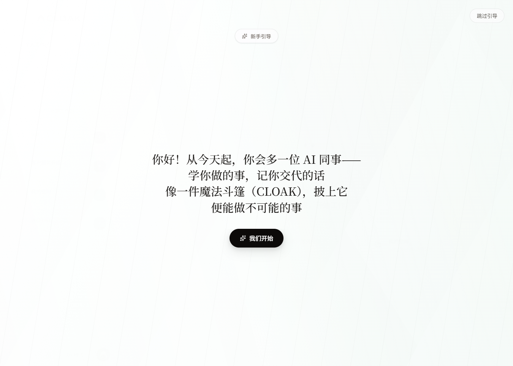
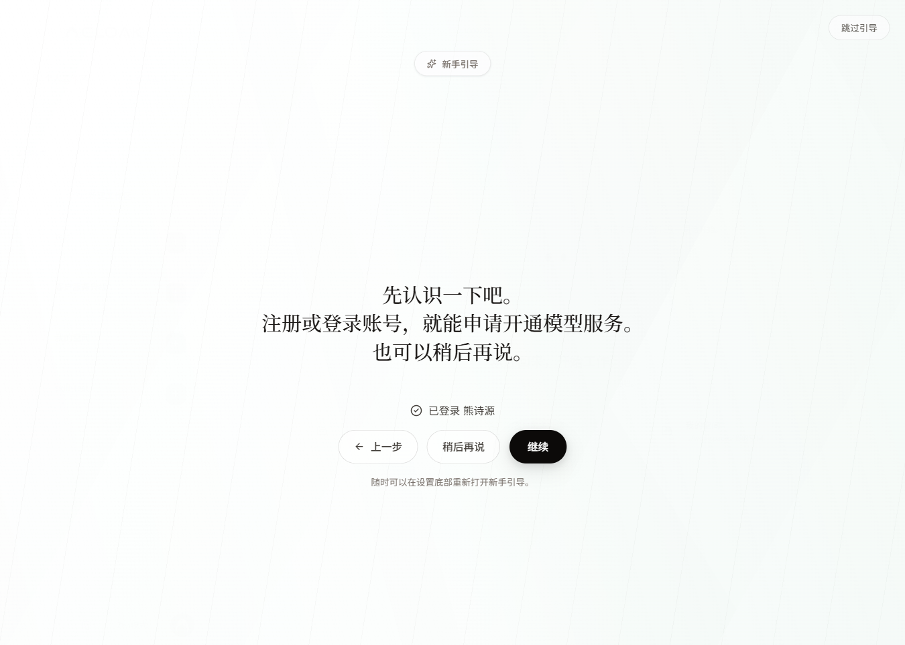
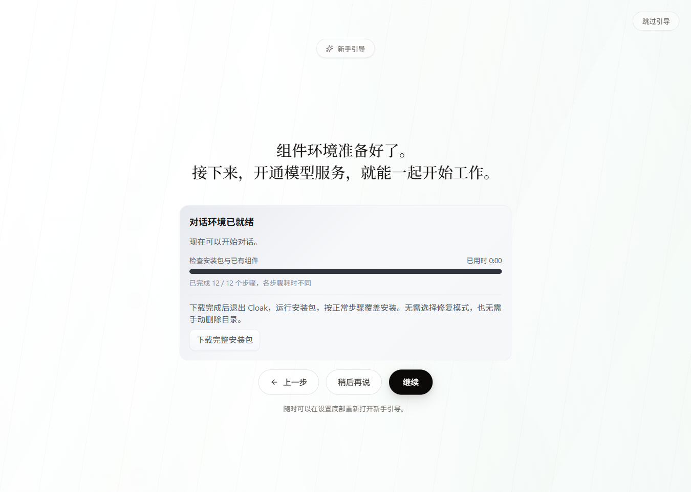
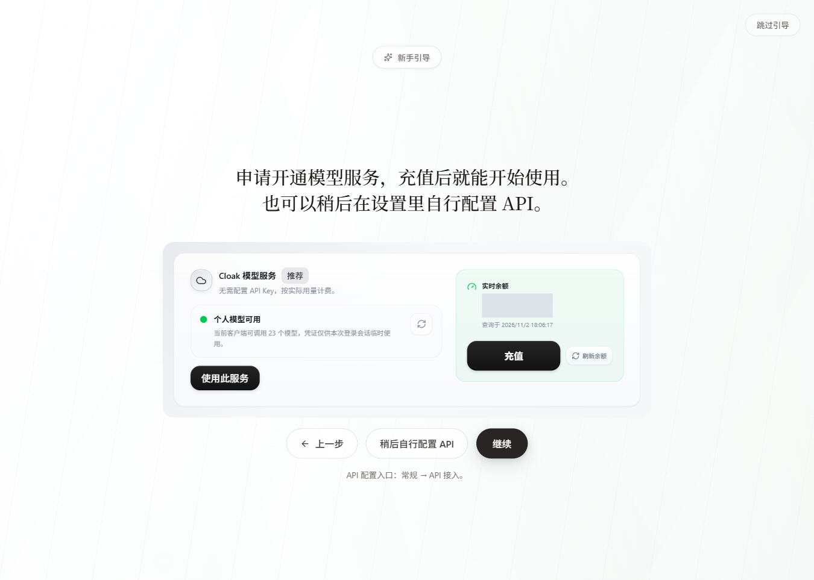
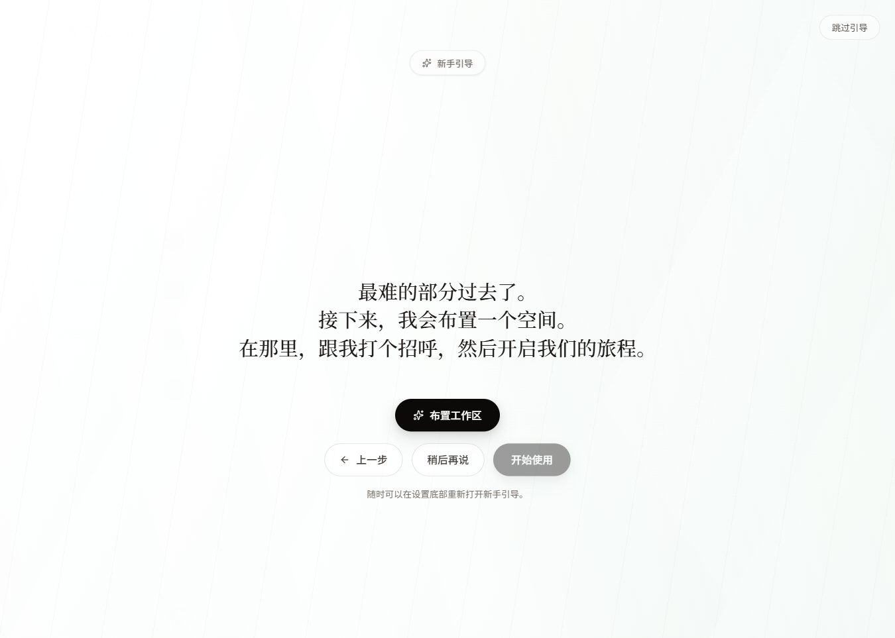
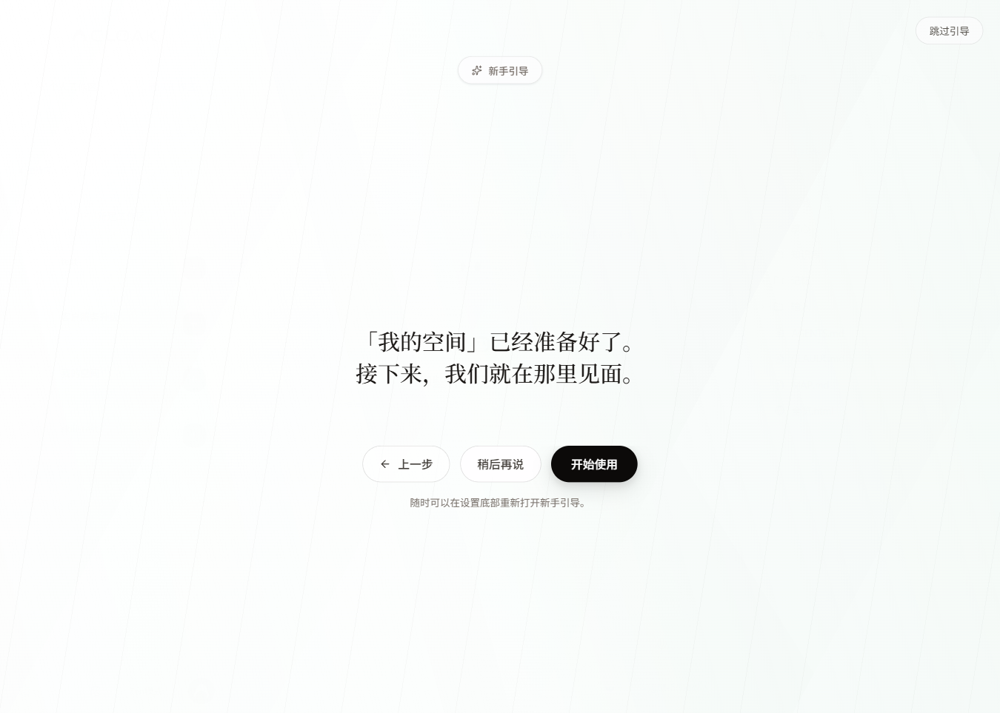
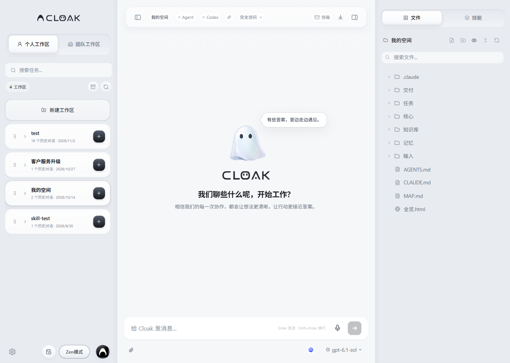

# 初始引导

第一次打开 Cloak 时，按照引导完成账号、组件环境、模型服务和工作区准备。之后也可以在设置底部点击 `新手引导` 重新查看。

## 1. 开始引导

在欢迎页点击 `我们开始`。暂时不配置时，点击右上角 `跳过引导`。

## 2. 注册或登录账号

点击 `注册账号` 或 `已有账号，去登录`，按照表单完成操作。已经登录时，这里会显示登录状态，点击 `继续`。

也可以点击 `稍后再说`，之后使用自己的 API 配置。

## 3. 等待组件环境就绪

所需组件随安装包提供，启动时自动准备。引导会显示实际准备进度；显示 `对话环境已就绪` 后，点击 `继续`。

准备失败时，先按提示重试。仍然失败时，退出并重新打开 Cloak，或重新安装完整官方安装包。诊断入口在 `设置 → 系统与数据 → 诊断`。

## 4. 开通模型服务

已登录的用户可以在这里申请或使用 Cloak 模型服务，并查看余额、充值。

如果使用自己的 API Key，点击 `稍后自行配置 API`。完成引导后，到 `设置 → 常规 → 添加或管理 API` 添加配置，具体见[模型与环境配置](04-模型与环境配置.md)。

## 5. 准备工作区

点击 `布置工作区`，Cloak 会准备名为 `我的空间` 的个人工作区。已准备过时，会继续使用已有文件。

准备完成后，点击 `开始使用`。如果暂时不准备，可以点击 `稍后再说`。

进入主界面后，右侧 `文件` 面板可以看到输入、知识库、任务和交付等文件夹。

下一步可以查看[首次登录与工作区](03-首次登录与工作区.md)。
