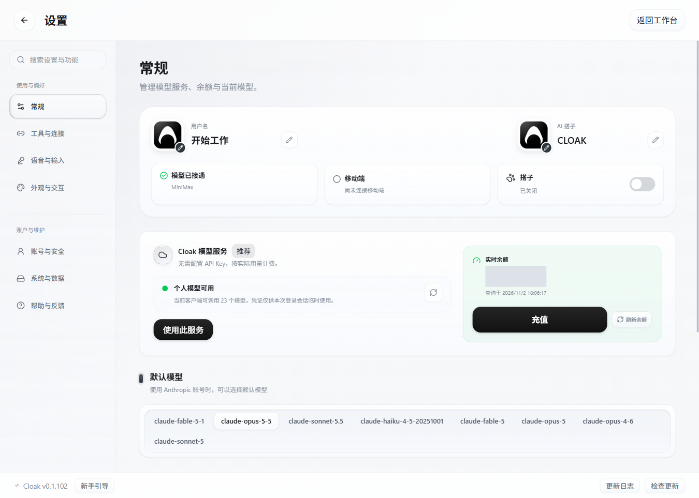
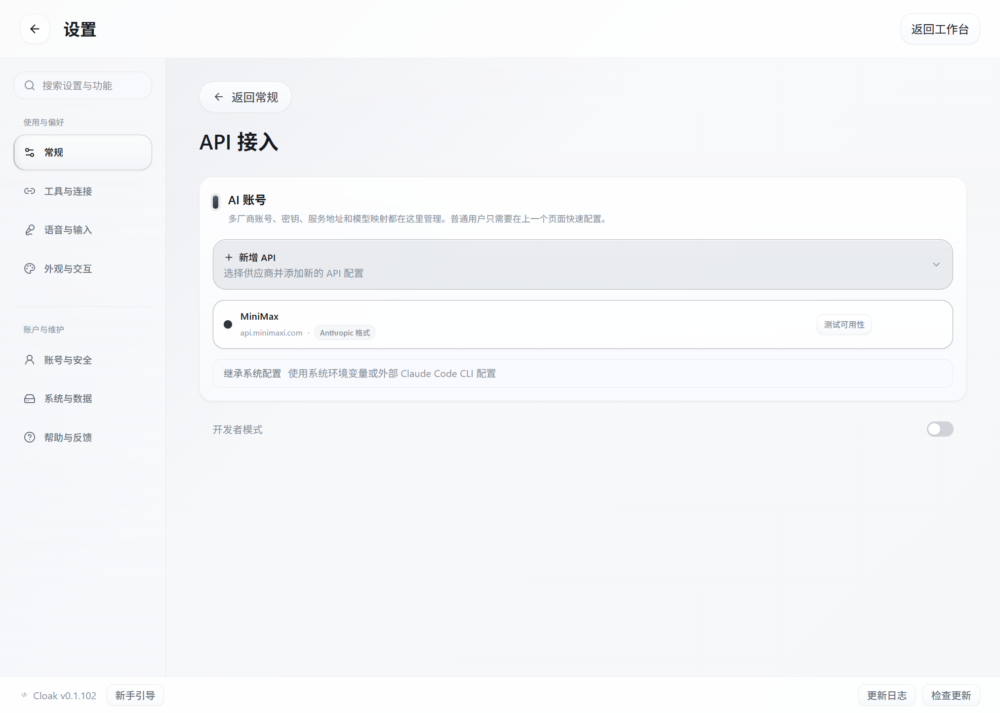
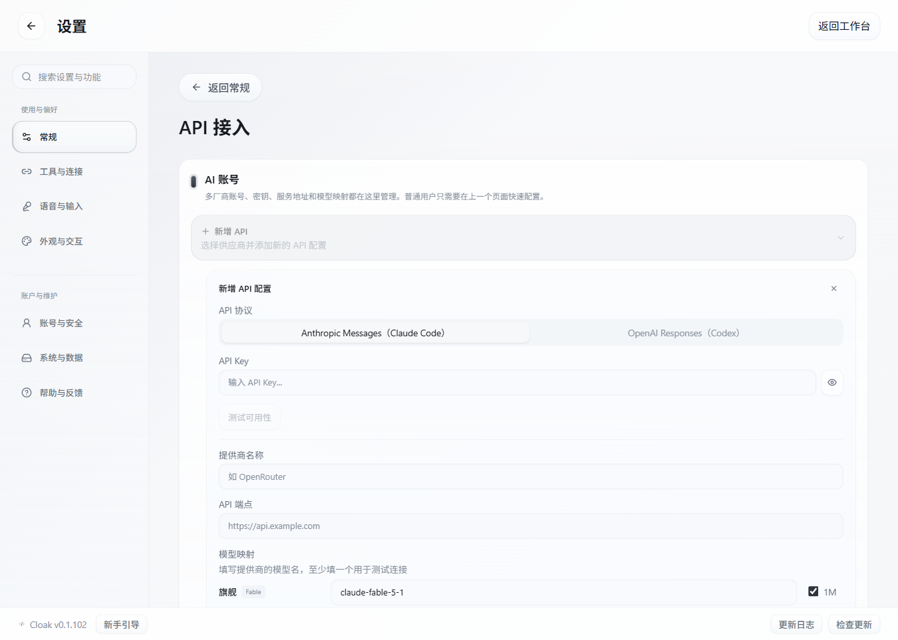
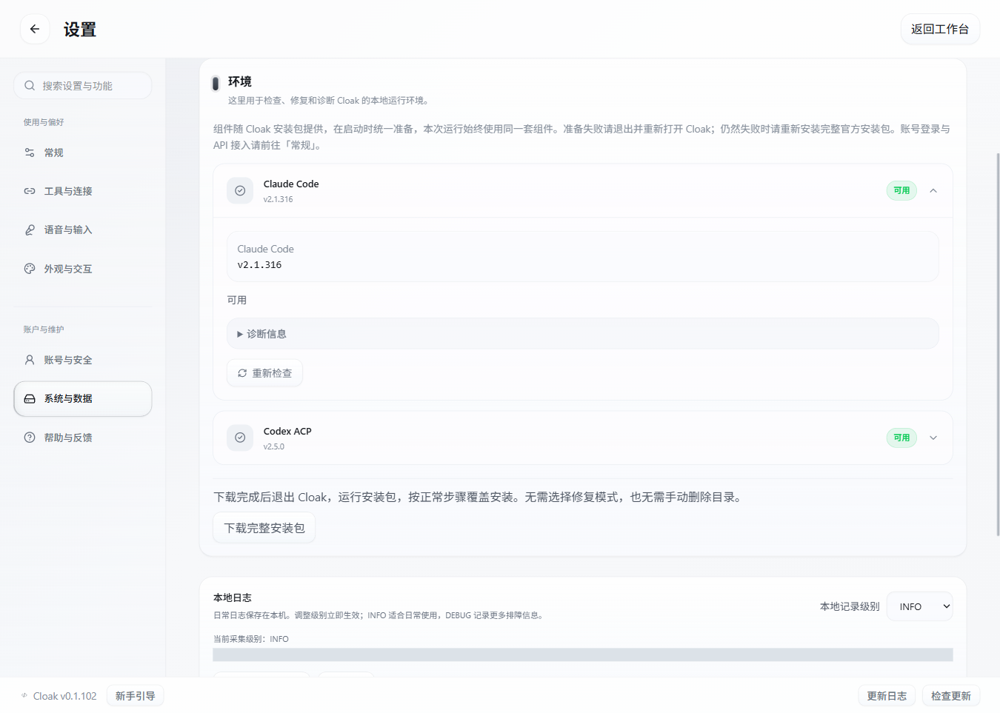

# 模型与环境配置

在 `设置 → 常规` 选择模型接入方式和默认模型；在 `系统与数据 → 诊断` 检查本机运行环境。

## 1. 打开设置

点击工作台左下角的齿轮图标，进入 `设置 → 常规`。

## 2. 选择模型接入方式

### Cloak 模型服务

登录 Cloak 账号后，在 `Cloak 模型服务` 卡片中查看开通状态。尚未开通时，按页面提示申请；已开通时，点击 `使用此服务`，再选择默认模型。

卡片右侧可以查看实时余额、充值和刷新余额。模型名单随账号权限变化，以实际页面为准。

### 自备 API Key

在 `其他接入方式 → 自备 API Key` 中选择已经保存的服务商。需要新增或编辑时，点击 `添加或管理 API`。

### 已有订阅

在 `已有订阅` 中选择 `Anthropic` 或 `OpenAI`，按页面提示完成账号授权。已登录过时，可以重新登录或刷新状态。

授权完成后回到 Cloak，确认所选接入方式和默认模型。

## 3. 选择默认模型

在 `常规` 页的 `默认模型` 区域点击模型名称。可选模型随账号、服务商和运行时变化。

选中的模型用于之后新建的任务。切换接入方式后，重新确认默认模型。

## 4. 添加或管理 API

打开 `设置 → 常规 → 添加或管理 API`，进入 `API 接入`。

展开 `新增 API`，选择预设服务商、自定义配置或导入 JSON 文件。已保存的配置可以测试可用性。

使用系统环境变量或外部 Claude Code 配置时，可以选择 `继承系统配置`。

### 自定义配置

1. 展开 `新增 API`，点击 `自定义配置`。
2. 选择 `API 协议`：`Anthropic Messages（Claude Code）` 或 `OpenAI Responses（Codex）`。
3. 填写 API Key、提供商名称和 API 端点。
4. 至少填写一个模型映射。
5. 点击 `测试可用性`，确认能正常连接后，点击 `确认并启用`。

尚未补全密钥、端点和模型时，页面会提示缺少的内容。

## 5. 使用团队模型

进入团队工作区后，使用组织开放的模型。没有可用模型或权限不足时，联系组织管理员检查成员、工作区和模型授权。

不要在会话、截图或群聊中发送完整 API Key 或 Token。

## 6. 检查 Agent 运行时

打开 `设置 → 系统与数据 → 诊断`，查看 Claude Code 和 Codex ACP 的状态、版本与诊断信息。

组件随 Cloak 安装包提供，启动时统一准备。这里用于查看状态和诊断，不需要单独安装 Claude Code。

组件准备失败时，先退出并重新打开 Cloak。仍然失败时，通过页面中的 `下载完整安装包` 获取安装包，退出客户端后覆盖安装。

需要使用账号授权时，回到 `常规 → 已有订阅` 完成登录。

## 7. 完成检查

1. 已选择模型接入方式和默认模型。
2. `系统与数据 → 应用与运行` 显示 `对话环境已就绪`。
3. 准备使用的 Agent 运行时显示可用。

完成后返回工作台开始使用。

下一步可以查看[微信接入](05-微信接入.md)。
