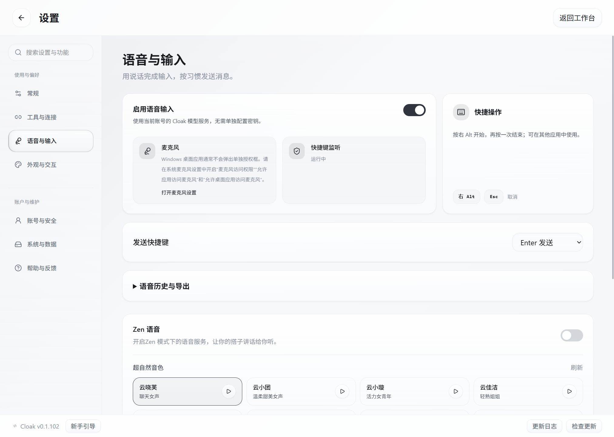
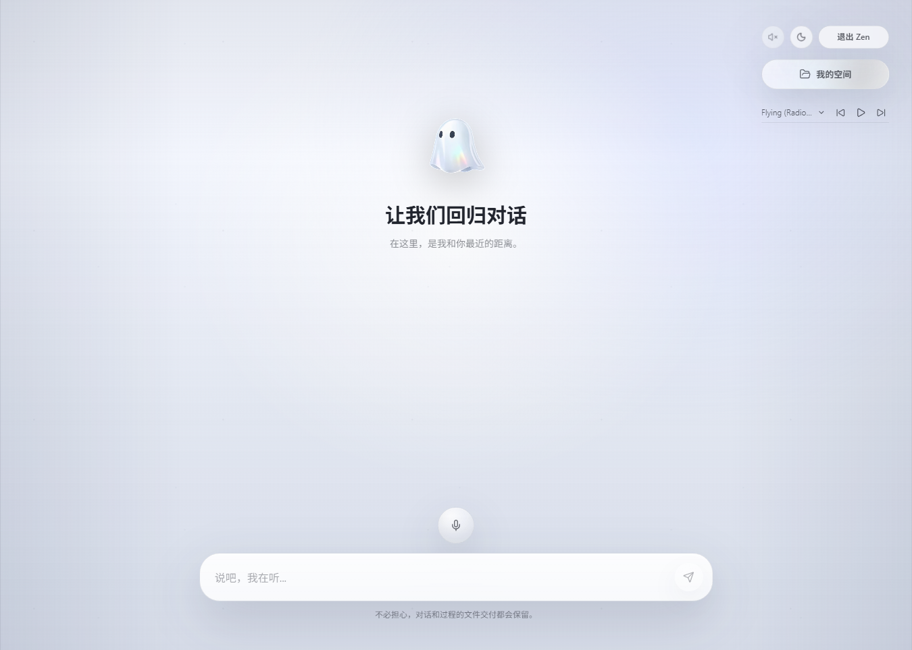

# Zen 模式与语音

Zen 模式沿用当前工作区和会话，用简洁的界面继续对话，也可以口述内容、收听 AI 回复。

## 1. 开启语音服务

1. 登录 Cloak，并开通 Cloak 模型服务，保持余额充足。
2. 打开 `设置 → 语音与输入`。
3. 需要口述时，开启 `启用语音输入`。
4. 需要 AI 语音回复时，开启 `Zen 语音`，选择音色。

点击音色旁的播放按钮可以试听；点击 `刷新` 可以重新获取音色。语音使用当前账号的 Cloak 模型服务，无需另填豆包或腾讯云密钥。

## 2. 进入 Zen 模式

1. 返回工作台，选择工作区并打开或新建会话。
2. 点击左侧栏底部的 `Zen模式`。

提示先选择工作区时，按 `Esc` 退出，选择后重新进入。

## 3. 文字与语音输入

在底部输入框中填写内容，按 `Enter` 发送。

切换到语音输入后，按界面提示开始和结束录音。检查识别文字后再发送；也可以继续编辑识别结果。

普通工作台也可以点击输入框旁的麦克风口述。跨应用语音输入的快捷键在 `设置 → 语音与输入` 中查看，例如 Windows 的右 Alt。

首次使用时，按系统提示开放麦克风权限。Windows 可以通过设置页中的 `打开麦克风设置` 检查权限。

## 4. AI 语音回复

在 `设置 → 语音与输入 → Zen 语音` 中开启语音输出并选择音色。Zen 模式右上角的声音按钮用于控制播放。

服务尚未开通、余额不足或连接失败时，按提示处理后重试。

## 5. 音乐与文件

右侧可以查看当前工作区文件和专注音乐。点击音乐名称选择曲目，使用播放、暂停和切换按钮控制音乐。云端曲目首次播放需要下载。

点击文件可以预览；不支持预览的格式会交给系统默认应用打开。

## 6. 退出与排障

点击右上角的 `退出 Zen`，或按 `Esc`，回到原工作台。工作区和会话保持不变。

- **麦克风不能使用**：检查语音输入开关、模型服务和系统麦克风权限。
- **AI 没有声音**：检查 Zen 语音开关、音色、系统音量和余额。
- **语音服务暂不可用**：先使用文字对话，稍后重试。

下一步可以查看[技能库](07-技能库.md)。
