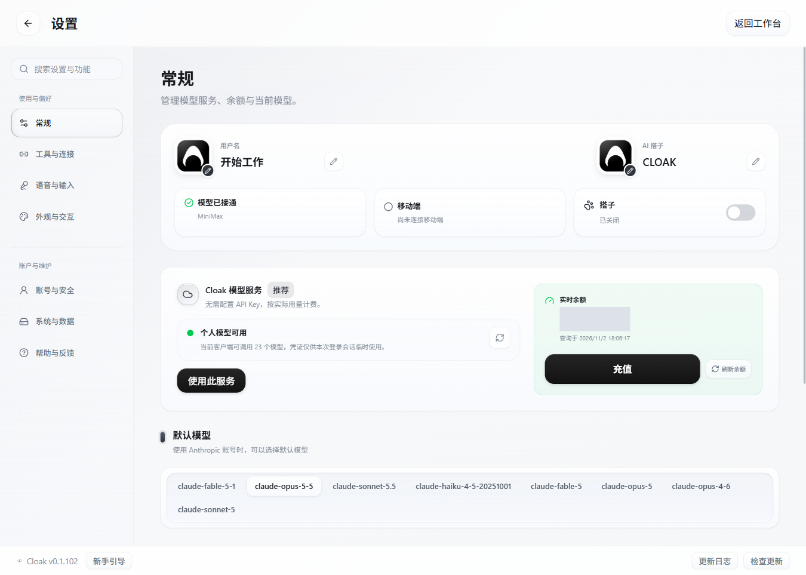
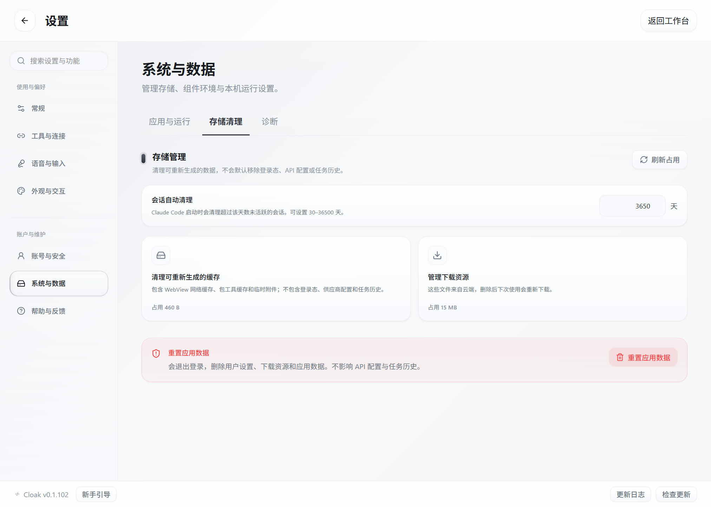
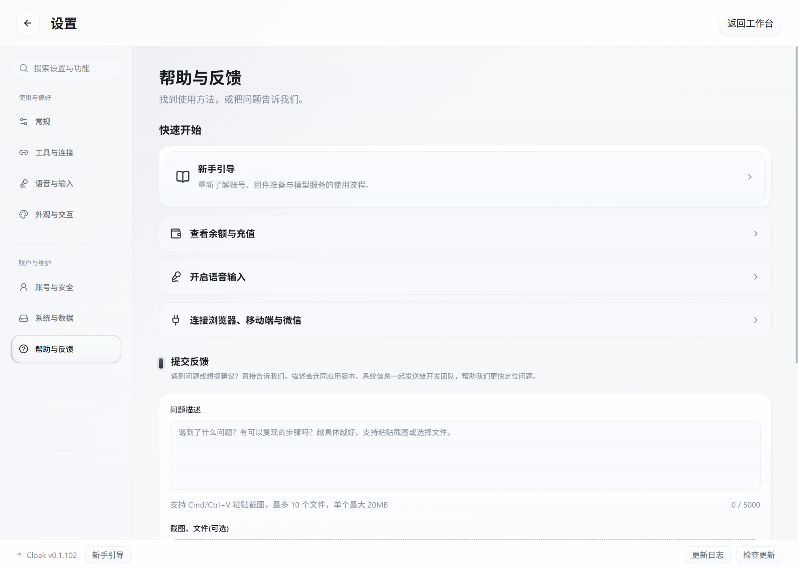

# 设置中心

设置中心管理模型、工具连接、语音、外观、账号、系统数据和反馈。点击工作台左下角的设置按钮进入。

## 1. 按用途查找设置

| 页面 | 主要用途 |
|---|---|
| `常规` | 选择模型接入方式和默认模型，查看余额，管理 API |
| `工具与连接` | 电脑与浏览器操作、移动端、微信、连接器 |
| `语音与输入` | 语音输入、发送快捷键、语音历史、Zen 语音和音色 |
| `外观与交互` | 主题、语言、字号、提示音、交付物通知、桌面搭子 |
| `账号与安全` | 登录账号、个人资料、密码与账号安全 |
| `系统与数据` | 应用运行、存储清理、组件诊断、日志和远程调试 |
| `帮助与反馈` | 使用引导、反馈表单和联系方式 |

左侧搜索框可以按功能名称查找入口。点击左上角返回箭头、右上角 `返回工作台`，或按 `Esc` 退出设置；有弹窗时先关闭弹窗。

## 2. 模型与 API

在 `常规` 中选择 Cloak 模型服务、自备 API Key 或已有订阅，再确认默认模型。

- 使用 Cloak 模型服务：登录并开通后，点击 `使用此服务`，按需充值。
- 使用自己的 API Key：从已保存的配置中选择，或点击 `添加或管理 API`。
- 使用已有订阅：选择 Anthropic 或 OpenAI，按提示完成授权。

完整步骤见[模型与环境配置](../1-安装与配置/04-模型与环境配置.md)。

## 3. 工具与连接

在 `工具与连接` 中进入对应功能：

- **Computer Use、Browser Use**：按页面提示开启并完成所需准备。
- **移动端**：从手机远程使用电脑上的 Cloak。
- **接入微信**：扫码后在微信里继续当前工作区的对话。
- **连接器管理**：管理外部工具和自定义 MCP 连接。

微信接入步骤见[微信接入](../1-安装与配置/05-微信接入.md)。

## 4. 语音与输入

在 `语音与输入` 中开启语音输入、选择发送快捷键，或打开 `语音历史与导出`。

`Zen 语音` 可以控制 AI 语音回复，并选择、试听音色。语音服务使用当前账号的 Cloak 模型服务，需要已开通且余额充足。

完整步骤见[专注模式与语音](../1-安装与配置/06-专注模式与语音.md)。

## 5. 外观与桌面搭子

在 `外观与交互` 中设置主题颜色、浅色或深色模式、语言、字号、完成提示音和交付物通知。

同一页可以开启桌面搭子、选择形象、调整大小或找回位置。完整步骤见[桌面工作搭子](07-桌面工作搭子.md)。

## 6. 账号与存储

修改账号资料和密码时，进入 `账号与安全`。清理本机文件时，进入 `系统与数据 → 存储清理`。

- **清理可重新生成的缓存**：清理网络缓存、包工具缓存和临时附件，保留登录状态、API 配置和任务历史。
- **管理下载资源**：清理已下载的搭子或指南资源，下次使用时重新下载。
- **重置应用数据**：退出登录，删除用户设置、下载资源和应用数据；API 配置和任务历史保留。

清理或重置前，按确认窗口核对范围。重置已经完成的数据无法从客户端恢复。

## 7. 诊断与运行环境

在 `系统与数据 → 应用与运行` 查看对话环境是否就绪；进入 `诊断` 查看运行时版本、日志和异常说明。

组件随安装包提供，启动时统一准备。准备失败时先退出并重新打开 Cloak；仍然失败时，下载完整安装包覆盖安装。

## 8. 提交反馈

打开 `帮助与反馈`。

1. 写清问题和复现步骤。
2. 粘贴截图，或点击 `选择文件` 添加附件。
3. 需要后续联系时，填写联系方式。
4. 点击 `提交反馈`。

问题描述最多 5000 个字符；最多添加 10 个文件，单个文件不超过 20 MB。提交前删除附件中的密钥和无关个人信息。

## 9. 版本和更新

底部显示当前版本，并提供 `新手引导`、`更新日志` 和 `检查更新`。

主题、语言、字号、声音和模型等设置通常立即保存。页面有单独保存按钮时，按提示保存。

更新方法见[更新与版本](../1-安装与配置/08-更新与版本.md)。
