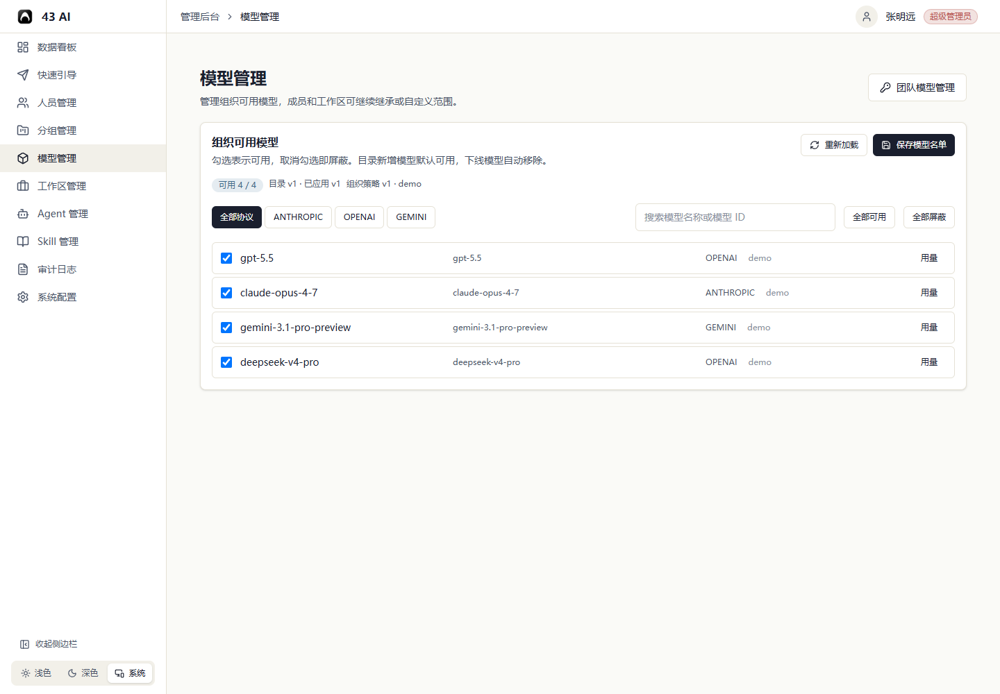
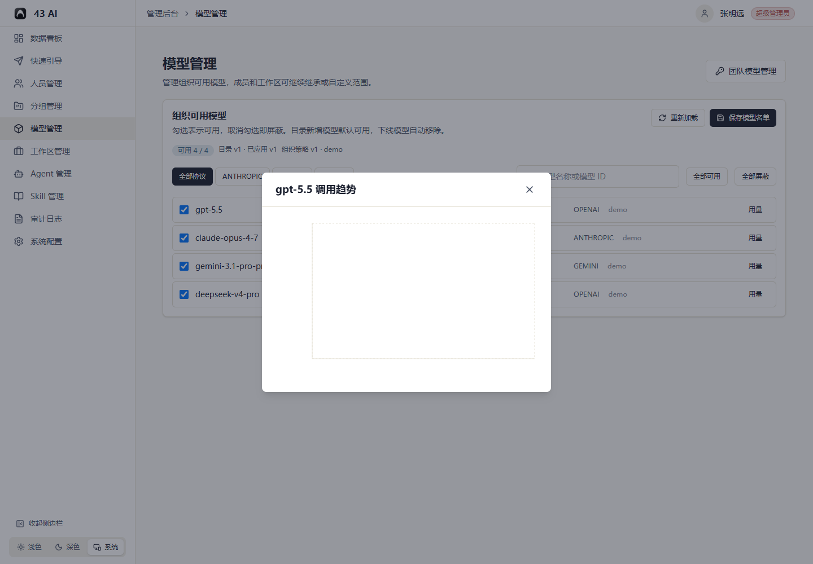

# 模型管理

在这里控制组织可以使用哪些模型。成员和工作区可以继续继承或自定义范围。

## 查看模型

页面显示组织可用模型数量和当前目录版本。可以按模型名称搜索，也可以按协议筛选。

模型卡片显示名称、模型 ID 和协议。实际可选模型以组织已开通的服务为准。

## 调整可用范围

1. 勾选要开放的模型，取消勾选要屏蔽的模型。
2. 需要批量选择时，使用 `全部可用` 或 `全部屏蔽`。
3. 点击 `保存模型名单`。

目录新增模型默认可用，下线模型自动移除。需要重新获取目录时，点击 `重新加载`。

## 查看用量

点击模型卡片中的 `用量`，查看调用趋势。

页面顶部的 `团队模型管理` 用于进入组织团队模型的相关管理。
